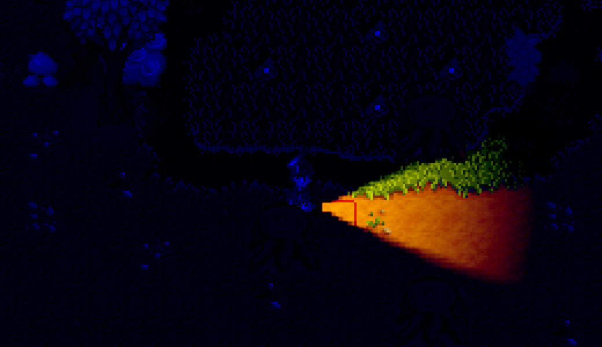
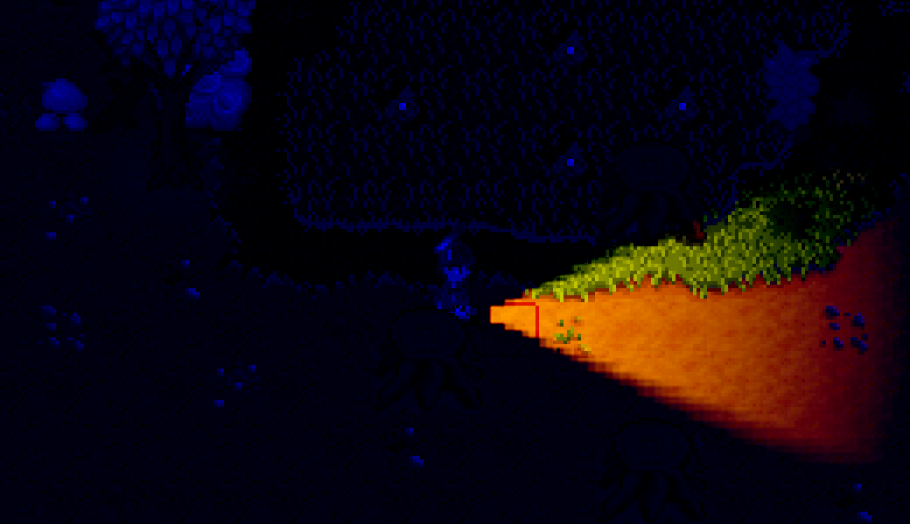
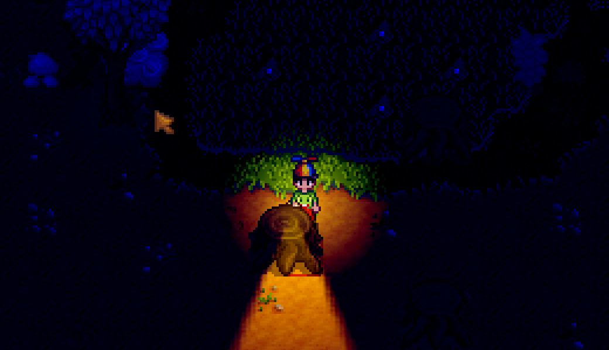
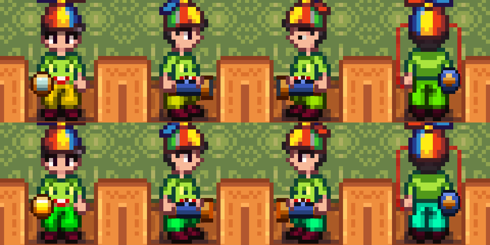
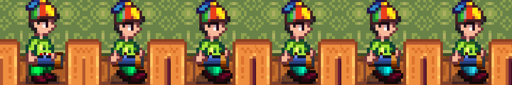
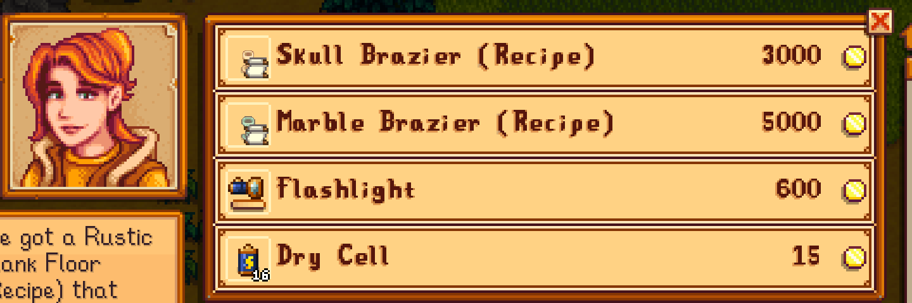
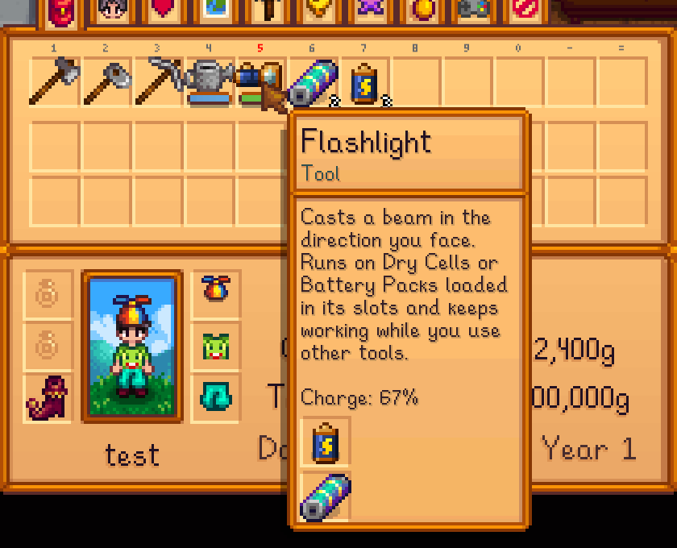
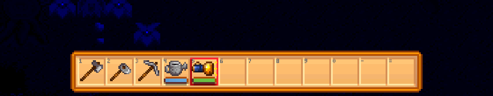

# Flashlight

A flashlight for Stardew Valley that casts a beam in the direction you face and runs on batteries. Buy it early, keep it in your backpack, and see at night without holding a torch.



This is an early build. It has been run in Stardew Valley 1.6.15 with SMAPI 4.5.2 and the beam, battery slots, shop, Battery Pack, flicker and held flashlight work. The art and the numbers are a first pass and it has not had real play-time yet, so feedback is very welcome (see below).

## What it adds

- **Flashlight** (a tool): sold at Robin's Carpenter's Shop (and Clint's Blacksmith if you turn on `SoldAtBlacksmith`), one to a player. Press **F** (or use the tool) to switch it on and off. It keeps shining while you use other tools, which a torch cannot do. The toolbar picture shows when it is on, and a charge bar under it works like the water bar of the watering can.
- **A cone of light**: a beam 7 tiles long in the direction you face, with nothing lit around you, like a real flashlight. It flickers now and then like an old flashlight with a loose cell, and much more often once the charge falls under a tenth of a full load. Trees, boulders, buildings and walls stop the beam and throw a shadow behind them, and other players in a multiplayer game see the same cone.
- **Held in your hand**: while the flashlight is the selected tool you are drawn holding it. It follows your hand as you walk, the beam starts at its lens, and from the front and back it is held in one hand.
- **Battery slots**: the flashlight has two, always two, like the bait slot on a fishing rod. It runs on a matching pair and needs both loaded, like a real one: two Dry Cells or two Battery Packs, never one of each and never just one. Right-click the flashlight with cells on the cursor to load them, one to a slot, and right-click it with an empty hand to take one out. Hover it to see what is loaded.
- **Dry Cell** (a battery): sold at Robin's in limited numbers, or crafted from 1 Copper Bar and 1 Coal for 12 cells once you reach Mining level 2. A pair lasts 4 in-game hours, and only while it is dark where you are.
- **Battery Pack** (the game's own): a pair of them goes in the slots instead. A pair of packs lasts 6 hours, two more than a pair of Dry Cells, and while it is in use the beam is 20 percent longer and a little brighter. Packs are found from a Lightning Rod or a Solar Panel, never sold, and you need two, so using them is a choice.
- **A letter from Robin**: a few days into a save she sends one letter about the flashlight to a player who does not have one yet. It is sent once for each player and only while she sells it. `SendMail` turns it off.

| | |
| --- | --- |
|  |  |





| | |
| --- | --- |
|  |  |



The balance reasoning, with the numbers it was checked against and how it is kept from being abused, is in [docs/BALANCE.md](docs/BALANCE.md).

## Settings

Edit `config.json` in the mod folder after the first run, or change them in game with Generic Mod Config Menu.

| Setting | Default | What it does |
| --- | --- | --- |
| `ToggleKey` | `F` | The button or buttons that switch the flashlight on and off, such as `F, LeftShoulder`. |
| `BeamLengthTiles` | `7` | How far the beam reaches (3 to 12). |
| `ShowInHand` | `true` | Draw the flashlight in your hand while it is selected. |
| `BeamShadows` | `true` | Trees, boulders, buildings and walls stop the beam and throw a shadow behind them. Turn it off for the plain cone. |
| `BatteryHours` | `4` | In-game hours a pair of Dry Cells lasts (1 to 12). |
| `UseBatteryPacks` | `true` | Whether the game's Battery Pack can be loaded. |
| `BatteryPackHours` | `6` | In-game hours a pair of Battery Packs lasts (1 to 48). |
| `BatteryPackBeamPercent` | `120` | Beam length while a pack is in use, as a percentage (100 to 200). |
| `FlashlightPrice` | `600` | Shop price of the flashlight. |
| `BatteryPrice` | `15` | Shop price of one Dry Cell. |
| `SoldAtCarpenter` | `true` | Whether Robin sells them. Turn off if another mod handles shops. |
| `SoldAtBlacksmith` | `false` | Whether Clint's Blacksmith sells them too. Works alone or together with Robin's. |
| `SendMail` | `true` | Whether Robin sends one letter about the flashlight. Only sent while she sells it. |
| `BatteryDailyStock` | `16` | How many Dry Cells the shop sells to one player each day. |
| `MaxBatteriesCarried` | `16` | The shop stops selling Dry Cells to someone carrying this many. |
| `BatteryOutOfStockPercent` | `15` | Chance in percent that Robin has no Dry Cells on a day. |
| `BatteryLowStockPercent` | `25` | Chance in percent that Robin has half the stock on a day. |
| `FlickerSecondsBetween` | `40` | Average seconds of use between random flickers. 0 turns them off. |

## Install

1. Install [SMAPI](https://smapi.io/) 4.2.1 or newer.
2. Put the `Flashlight` folder in `Stardew Valley/Mods`.

Needs Stardew Valley 1.6.9 or newer.

## Feedback

The numbers are a first pass, and what real players find is what will fix them. The most useful notes say how far into the game you are and what actually happened, such as how many nights a pair of Dry Cells lasted or how often the shelf was empty.

- **Something broke or looks wrong**: open a [bug report](https://github.com/Kkthnx-Stardew/Flashlight/issues/new?template=bug_report.yml) and link your SMAPI log from [smapi.io/log](https://smapi.io/log).
- **The prices, battery life, stock or brightness feel wrong**: open a [balance feedback](https://github.com/Kkthnx-Stardew/Flashlight/issues/new?template=balance_feedback.yml) note.
- **Quick thoughts**: comment on the mod page on Nexus Mods.

Type `flashlight_report` in the SMAPI console and paste what it prints. It lists the settings you changed and a tally of nights used, hours lit and cells used, which makes balance feedback much easier to act on. The tally is kept in `stats.json` in the mod folder, on your own computer. Nothing is ever sent anywhere.

## Known limits

- The battery slots, the charge bar, the tooltip line, the held flashlight and the one-flashlight rule use a few small Harmony patches on the game's own code. They only act on the flashlight. SMAPI lists the mod as one that changes game code for that reason.
- Multiplayer has had a small test and no more. With a host and one joining player on the same computer, each saw the other's beam as a cone pointing the right way, the flicker showed on both screens, and a beam was removed when its player left. Everyone in the game needs the mod to see the cone: a player without it sees a plain round glow. Three or more players, split screen, other people's internet connections and other mods that change lights are untested. Please report what you find.
- Shop days for Robin and the Mining level of the recipe are not checked against the rest of the game.
- If another mod changes how the farmer is drawn (a different farmer sheet or a custom farmer renderer), the held flashlight might sit in the wrong place. Turn it off with `ShowInHand` and report it.

## Building

The mod needs the game's files to build, so it cannot be built on a GitHub runner. With the game installed:

```
dotnet build Flashlight/Flashlight.csproj
```

By default the build copies the mod into your `Mods` folder. Pass `-p:EnableModDeploy=false -p:EnableModZip=false` to build without that.

The tests cover the code that has no game dependencies, plus the manifest, translations and picture sizes:

```
dotnet test Flashlight.Tests
```

The pictures are drawn by `art/Generate-Art.ps1`, so they can be adjusted and regenerated:

```
powershell -ExecutionPolicy Bypass -File art/Generate-Art.ps1
```

See [docs/ROADMAP.md](docs/ROADMAP.md) for what is planned next.

## License

MIT, see [LICENSE.txt](LICENSE.txt). This is a fan-made mod and is not affiliated with ConcernedApe.
